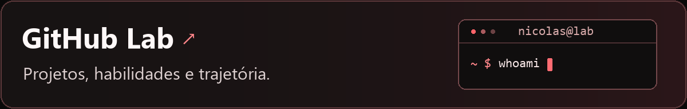
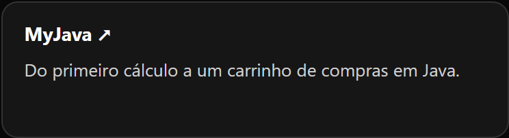

## Projetos para explorar

## Ferramentas do meu dia a dia

**SQL / PL/SQL** &nbsp;  MongoDB &nbsp;  Postman &nbsp;  Jira &nbsp;  JavaScript &nbsp;  HTML &nbsp;  CSS

Um pouco da minha experiência

- **Dados e integrações.** Faço consultas e ajustes com SQL e PL/SQL. Uso MongoDB, analiso logs em JSON e XML e verifico requisições de API com o Postman.
- **Suporte e incidentes.** Tenho experiência com Jira e com o acompanhamento de chamados entre os níveis N1, N2 e N3. Na ÚnicoPag, liderei 2 pessoas no atendimento ao cliente e encaminhei incidentes sistêmicos às equipes responsáveis.

[Minha trajetória ↗](https://nicolaslacerda.com/trajetoria) · [LinkedIn ↗](https://www.linkedin.com/in/nicolas-lacerda-0b95371b2/)
